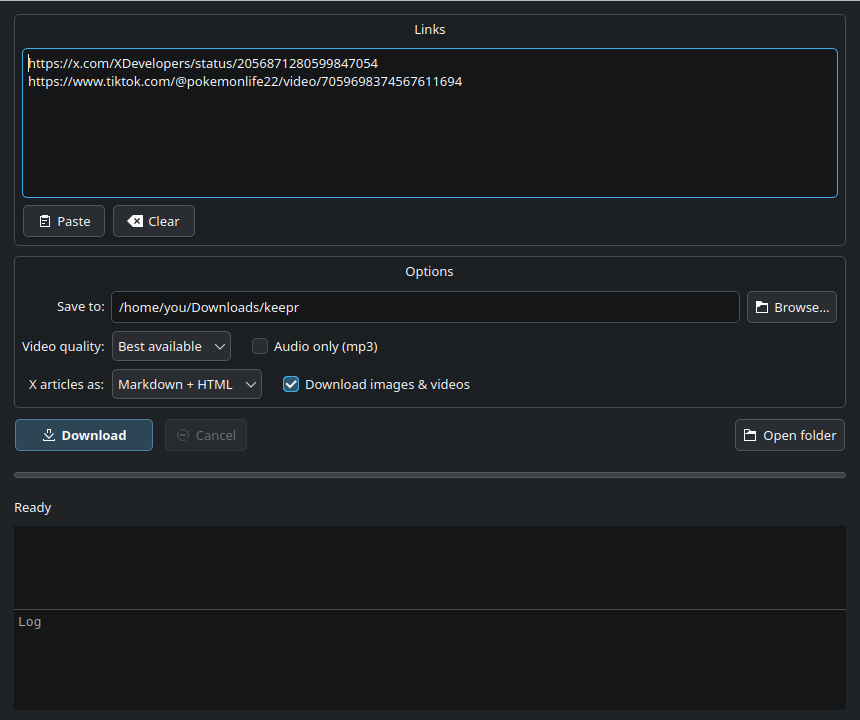

<p align="center">
  
</p>

<h1 align="center">Keepr</h1>

<p align="center">
  Save videos from X, TikTok, YouTube and ~1800 other sites.<br>
  Archive X Articles offline with every image, code block and table intact.
</p>

<p align="center">
  
  
  
</p>

<p align="center">
  
</p>

## Features

- **Videos:** X, TikTok, YouTube, Instagram, Reddit, Vimeo and many more, through [yt-dlp](https://github.com/yt-dlp/yt-dlp). Pick a quality cap or save audio only (mp3).
- **X Articles, complete:** headings, bold, italic and strike-through text, links, nested lists, quotes, **code blocks**, tables, LaTeX math, dividers, embedded posts, and **every image and video** downloaded locally.
- **X posts:** text, full-size photos and the best-quality video.
- **Readable output:** each article is saved as Markdown (with YAML front matter), a self-contained HTML page (light and dark themes, works right-to-left), and the raw JSON so nothing is lost.
- **Two ways to use it:** a desktop app (`keepr-gui`) or a command-line tool (`keepr`) for scripts and batches.
- **No account needed** for public posts. There is no login and no API key.

## Install

### 1. Dependencies

A C++20 compiler, CMake ≥ 3.20, libcurl and nlohmann-json. nlohmann-json is downloaded automatically if it's missing. Qt 6 is optional and only needed for the desktop app.

```bash
# Arch
sudo pacman -S --needed base-devel cmake ninja curl nlohmann-json qt6-base
# Debian / Ubuntu
sudo apt install build-essential cmake ninja-build libcurl4-openssl-dev nlohmann-json3-dev qt6-base-dev
```

### 2. Build and install

```bash
git clone https://github.com/alnemari-m/keepr.git && cd keepr
cmake -S . -B build -G Ninja
cmake --build build
./build/keepr_tests                      # run the tests (should print "0 failed")
cmake --install build --prefix ~/.local  # installs keepr, keepr-gui, the icon and the menu entry
```

Make sure `~/.local/bin` is on your `PATH`.

### 3. yt-dlp (for videos)

Videos need a **recent** yt-dlp with browser impersonation, because TikTok blocks old versions:

```bash
python3 -m venv ~/.venvs/yt-dlp
~/.venvs/yt-dlp/bin/pip install -U "yt-dlp[default,curl-cffi]"
echo 'export KEEPR_YTDLP=~/.venvs/yt-dlp/bin/yt-dlp' >> ~/.bashrc
```

Update it now and then with the same `pip install -U` command, because sites change often.

## Usage

### Desktop app

Open **Keepr** from your applications menu, or run `keepr-gui`.

1. Paste one or more links, or drag them onto the window.
2. Choose where to save, the video quality, and whether articles are saved as Markdown, HTML or both.
3. Click **Download**. Watch progress in the log, and double-click a finished item to open it.

```bash
keepr-gui URL...           # open with links already filled in
keepr-gui --start URL...   # fill in the links and start downloading right away
```

### Command line

```bash
keepr https://x.com/karpathy/status/2002118205729562949        # X Article
keepr https://x.com/someone/status/123456789                   # X post (text + photos + video)
keepr https://www.tiktok.com/@user/video/7059698374567611694   # TikTok
keepr -q 720 https://youtu.be/...                              # cap at 720p
keepr -a https://www.youtube.com/watch?v=...                   # audio only (mp3)
keepr -i urls.txt -o ~/Archive                                 # batch from a file
keepr --cookies-from-browser firefox https://www.instagram.com/reel/...   # login-gated content
```

Run `keepr --help` for every option.

### Where files go

```
downloads/
├── x/<handle>/<post-id>-<article-title>/
│   ├── article.md        # Markdown with front matter and local image links
│   ├── article.html      # self-contained page, open in any browser
│   ├── article.json      # raw source data
│   └── assets/           # cover.jpg, img-01.jpg, video-01.mp4, ...
├── x/<handle>/<post-id>/ # ordinary post: post.md, post.html, post.json, img-01.jpg, video-01.mp4
└── videos/<Site>/<uploader>/<title> [<id>].mp4
```

## How it works

| Link | What Keepr does |
|---|---|
| `x.com` / `twitter.com` post | Reads the public [FxTwitter](https://github.com/FixTweet/FxTwitter) API (no login). If the post contains an Article, its content blocks are turned into Markdown and HTML (`src/x_render.cpp`). Images are fetched at original size and videos at the highest bitrate. |
| Anything else | Runs `yt-dlp` as a child process. The URL goes after `--` and no shell is used, so links can't inject commands. |

The desktop app is a thin Qt front end. It runs the `keepr` engine for each link, so the app and the command line always behave the same.

## Tips and limits

- Use the **post** link (`x.com/<user>/status/<id>`), not `x.com/i/article/<id>`. The article-only link can't be looked up.
- Private, protected, deleted or age-restricted X posts can't be fetched without a login.
- If TikTok says "Your IP address is blocked", the video is region-locked. Try `--cookies-from-browser` or another network.
- Only download content you have the right to keep, and respect creators and each site's terms.

## Project layout

```
src/main.cpp        command-line entry point
src/url.*           X link detection
src/http.*          libcurl requests and streaming downloads
src/video.*         yt-dlp command builder and runner
src/x_render.*      X Article / post → Markdown + HTML (pure, unit-tested)
src/x_download.*    fetching, asset downloads, file output
src/util.*          UTF-8/UTF-16, escaping, slugs
gui/                Qt 6 desktop app, icon, .desktop entry
tests/              unit tests and a synthetic article fixture
```
